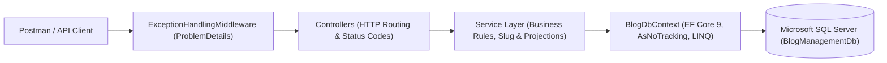
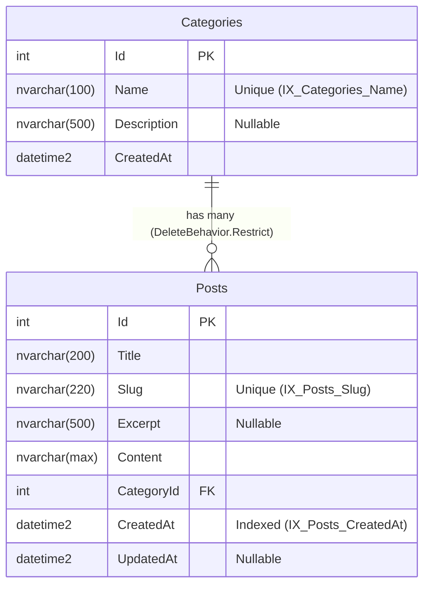
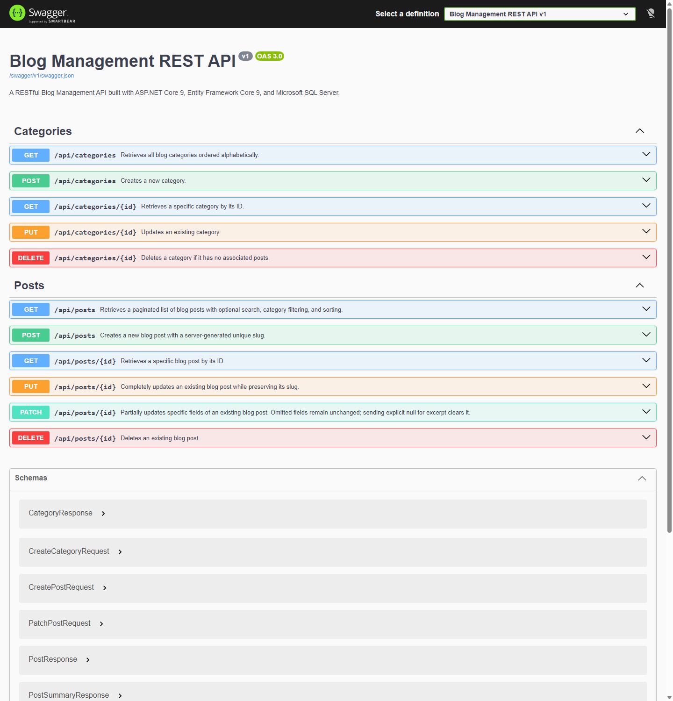

# Blog Management REST API

A RESTful Blog Management API built with **ASP.NET Core 9**, **Entity Framework Core 9**, and **Microsoft SQL Server**.

> **Portfolio Note:** This is a self-built backend reference and portfolio project designed to demonstrate production-oriented RESTful API engineering, relational database design, automated testing, and API documentation standards.

---

## 1. Project Overview

**Blog Management REST API (V1.0)** is a structured backend service for managing Blog Categories and Posts. Rather than a minimal CRUD demo, it implements real-world backend practices:

* Clean separation between **Presentation (Controllers)**, **Application (Services)**, and **Data Access (`BlogDbContext`)**
* Explicit **DTO contracts** separated from EF Core database entities
* **Server-side Slug generation** with normalization and incremental collision handling
* **True partial updates (`PATCH`)** via a custom `Optional<T>` wrapper distinguishing omitted fields from explicit `null`
* **Database-level Search, Category Filtering, Sorting, and Pagination** (`AsNoTracking` + `Select` projections)
* **RFC 9110 `ProblemDetails`** global exception and validation handling
* **69 automated xUnit tests** (Unit + `WebApplicationFactory` SQLite in-memory integration tests) and a runnable **Postman test suite**

---

## 2. Features

* **Categories Management:** List, retrieve by ID, create, update, and delete categories with case-insensitive unique name enforcement (`409 Conflict`) and `DeleteBehavior.Restrict` protection when posts exist (`409 Conflict`).
* **Posts Management:** Full CRUD plus partial `PATCH` updates (`{"excerpt": null}` clears `Excerpt`; omitted fields stay untouched).
* **Automatic Slug Engine:** Normalizes titles (e.g., `"ASP.NET Core"` -> `"asp-net-core"`, `"C# & .NET 9"` -> `"c-net-9"`), appends incremental suffixes (`-2`, `-3`, ...) on duplicate titles, retries concurrent DB unique collisions, and preserves existing slugs across `PUT`/`PATCH`.
* **Search, Filtering, Sorting & Pagination:** Filter by `categoryId`, case-insensitive `search` across `Title` and `Content`, sort by `createdAt` or `title` (`asc`/`desc`), and paginate up to `pageSize = 100`.
* **Validation & Error Contract:** Consistent `application/problem+json` error payloads (`400`, `404`, `409`, `500`) without leaking stack traces or SQL details.
* **OpenAPI / Swagger UI & Postman Collection:** XML-documented Swagger UI plus an exportable Postman collection with automated assertions.

---

## 3. Technology Stack

| Layer / Tool | Technology |
| :--- | :--- |
| Framework | ASP.NET Core 9 Web API (`net9.0`) |
| Language | C# 13 |
| Database | Microsoft SQL Server (LocalDB / SQL Server) |
| ORM | Entity Framework Core 9 |
| API Documentation | Swashbuckle.AspNetCore (`10.3.1`, OpenAPI 3.0) |
| Automated Testing | xUnit, `Microsoft.AspNetCore.Mvc.Testing`, EF Core SQLite |
| API Client Testing | Postman Collection v2.1 |
| Version Control | Git & GitHub |

---

## 4. Architecture

The API follows a **Layered Architecture** intentionally kept free of redundant Generic Repository or Unit-of-Work wrappers—injecting `BlogDbContext` directly into the Service Layer while isolating HTTP concerns inside Controllers.



### Key Design Decisions

* **Direct `BlogDbContext` in Services:** Avoids leaky Generic Repository abstractions while keeping business rules out of controllers.
* **Lightweight List Projections (`PostSummaryResponse`):** `GET /api/posts` projects directly in SQL without selecting `nvarchar(max)` `Content`, `Excerpt`, or `UpdatedAt`.
* **Custom `Optional<T>` Converter for `PATCH`:** Eliminates the standard `System.Text.Json` ambiguity between omitted properties and explicit `null`.
* **`CancellationToken` Propagation:** Flows from HTTP request abort tokens down to every EF Core query and `SaveChangesAsync`.

---

## 5. Database Schema

Database name: `BlogManagementDb`



* **Delete Rule (`BR-07`):** Configured with `DeleteBehavior.Restrict` (`ON DELETE NO ACTION` in SQL Server) so a category with existing posts cannot be deleted (`409 Conflict`).

---

## 6. API Endpoints

Base URL (Local HTTPS): `https://localhost:7080/api`

### Categories

| Method | Endpoint | Success | Error Responses |
| :--- | :--- | :--- | :--- |
| `GET` | `/api/categories` | `200 OK` | — |
| `GET` | `/api/categories/{id}` | `200 OK` | `404 Not Found` |
| `POST` | `/api/categories` | `201 Created` | `400 Bad Request`, `409 Conflict` |
| `PUT` | `/api/categories/{id}` | `204 No Content` | `400 Bad Request`, `404 Not Found`, `409 Conflict` |
| `DELETE` | `/api/categories/{id}` | `204 No Content` | `404 Not Found`, `409 Conflict` |

### Posts

| Method | Endpoint | Success | Error Responses |
| :--- | :--- | :--- | :--- |
| `GET` | `/api/posts` | `200 OK` | `400 Bad Request` |
| `GET` | `/api/posts/{id}` | `200 OK` | `404 Not Found` |
| `POST` | `/api/posts` | `201 Created` | `400 Bad Request`, `409 Conflict` |
| `PUT` | `/api/posts/{id}` | `204 No Content` | `400 Bad Request`, `404 Not Found` |
| `PATCH` | `/api/posts/{id}` | `204 No Content` | `400 Bad Request`, `404 Not Found` |
| `DELETE` | `/api/posts/{id}` | `204 No Content` | `404 Not Found` |

#### `GET /api/posts` Query Parameters

| Parameter | Default | Allowed / Constraints |
| :--- | :--- | :--- |
| `search` | `null` | Case-insensitive search across `Title` and `Content` |
| `categoryId` | `null` | Positive integer (`>= 1`) |
| `pageNumber` | `1` | Minimum `1` |
| `pageSize` | `10` | Minimum `1`, Maximum `100` |
| `sortBy` | `createdAt` | `createdAt` or `title` |
| `sortOrder` | `desc` | `asc` or `desc` |

---

## 7. Request & Response Examples

### Create Post (`POST /api/posts`)

Request:

```json
{
  "title": "Getting Started with ASP.NET Core",
  "excerpt": "An introduction to ASP.NET Core Web API.",
  "content": "ASP.NET Core is a modern framework for building web applications and APIs.",
  "categoryId": 1
}
```

Response (`201 Created`):

```json
{
  "id": 1,
  "title": "Getting Started with ASP.NET Core",
  "slug": "getting-started-with-asp-net-core",
  "excerpt": "An introduction to ASP.NET Core Web API.",
  "content": "ASP.NET Core is a modern framework for building web applications and APIs.",
  "categoryId": 1,
  "categoryName": "ASP.NET Core",
  "createdAt": "2026-11-26T10:00:00Z",
  "updatedAt": null
}
```

### Get Paginated Posts (`GET /api/posts?search=asp.net&categoryId=1&pageNumber=1&pageSize=10&sortBy=createdAt&sortOrder=desc`)

Response (`200 OK`):

```json
{
  "items": [
    {
      "id": 1,
      "title": "Getting Started with ASP.NET Core",
      "slug": "getting-started-with-asp-net-core",
      "categoryId": 1,
      "categoryName": "ASP.NET Core",
      "createdAt": "2026-11-26T10:00:00Z"
    }
  ],
  "pageNumber": 1,
  "pageSize": 10,
  "totalCount": 1,
  "totalPages": 1
}
```

### Partial Update (`PATCH /api/posts/1`)

Clears `excerpt` while keeping `title`, `content`, `categoryId`, and `slug` unchanged (`204 No Content`):

```json
{
  "excerpt": null
}
```

### Validation Error (`400 Bad Request` — `application/problem+json`)

```json
{
  "type": "https://tools.ietf.org/html/rfc9110#section-15.5.1",
  "title": "Validation Error",
  "status": 400,
  "detail": "One or more validation errors occurred.",
  "instance": "/api/posts",
  "errors": {
    "Title": [
      "The Title field is required."
    ]
  }
}
```

---

## 8. Installation Guide

### Prerequisites

* [.NET 9 SDK](https://dotnet.microsoft.com/download/dotnet/9.0) (`9.0.x`)
* Microsoft SQL Server or SQL Server LocalDB (`MSSQLLocalDB`)
* `dotnet-ef` CLI tool (`dotnet tool install --global dotnet-ef --version 9.*` or compatible `10.x`)

### Clone & Restore

```bash
git clone https://github.com/<your-username>/blog-management-rest-api.git
cd blog-management-rest-api
dotnet restore
```

---

## 9. Database Configuration

Local development uses `src/BlogManagement.API/appsettings.Development.json` pointing to SQL Server LocalDB:

```json
{
  "ConnectionStrings": {
    "DefaultConnection": "Server=(localdb)\\MSSQLLocalDB;Database=BlogManagementDb;Trusted_Connection=True;MultipleActiveResultSets=true;Encrypt=True;TrustServerCertificate=True;"
  }
}
```

For SQL Server Express or named instances, adjust `Server=...` in `appsettings.Development.json` or set it via User Secrets / Environment Variables:

```bash
dotnet user-secrets set "ConnectionStrings:DefaultConnection" "<your-connection-string>" --project src/BlogManagement.API
```

> Never commit production credentials or secrets to `appsettings.json` or Git history.

---

## 10. Migration Instructions & Running the API

Ensure SQL Server / LocalDB is running (`sqllocaldb start MSSQLLocalDB` on Windows), then apply migrations:

```bash
dotnet ef database update --project src/BlogManagement.API
```

Start the API:

```bash
dotnet run --project src/BlogManagement.API --launch-profile https
```

In `Development` mode, `DbSeeder` automatically populates sample Categories and Posts only when the database is empty.

---

## 11. Swagger Documentation

Once the API is running in `Development`, open Swagger UI at:

* `https://localhost:7080/swagger` (or `http://localhost:5080/swagger`)
* OpenAPI JSON specification: `/swagger/v1/swagger.json`

---

## 12. Postman Collection

Import both files from `postman/` into Postman:

1. `postman/BlogManagement.postman_collection.json`
2. `postman/BlogManagement.local.postman_environment.json`

Select the **`Blog Management API - Local`** environment and run the collection via **Collection Runner**. All requests include `pm.test(...)` assertions covering `TC-01` through `TC-17` and automatically clean up created test records at the end.

---

## 13. Testing Instructions

Run the complete automated test suite (Unit Tests + `WebApplicationFactory` SQLite In-Memory Integration Tests):

```bash
dotnet test
```

The test suite (`69` tests in `tests/BlogManagement.Tests`) verifies:

* `ExceptionHandlingMiddleware` (`400`, `404`, `409`, and `500` secret isolation)
* `SlugGenerator` normalization, diacritics, truncation, and numeric suffixes
* `Optional<T>` JSON deserialization (omitted vs explicit `null`) and `PatchPostRequest` validation
* `PostQueryParameters` validation and architectural bounds (`MaxPageSize = 100`, allowlisted sort fields)
* `CategoryService` and `PostService` business rules against relational SQLite
* End-to-end HTTP integration tests for all `TC-01`..`TC-17` scenarios

---

## 14. Screenshots

### Swagger UI Overview



---

## 15. Future Enhancements (Version 2.0)

Planned extensions on top of this V1.0 core API:

* **JWT Authentication & Refresh Tokens:** Secure write/admin endpoints with token rotation.
* **Role-Based Authorization:** Separate `Admin`, `Editor`, and `Author` permissions.
* **Author / User Management:** Link posts to authenticated authors.
* **Media Upload:** Post thumbnail / image storage integration.
* **Soft Delete & Audit Trail:** Recoverable deletions with query filters.
* **Comments API:** Moderated reader comments per post.
* **Output Caching & Rate Limiting:** Built-in ASP.NET Core 9 caching and abuse protection.
